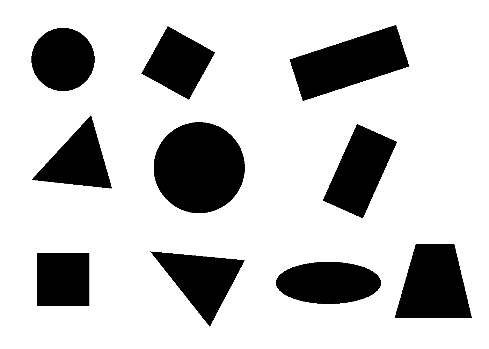
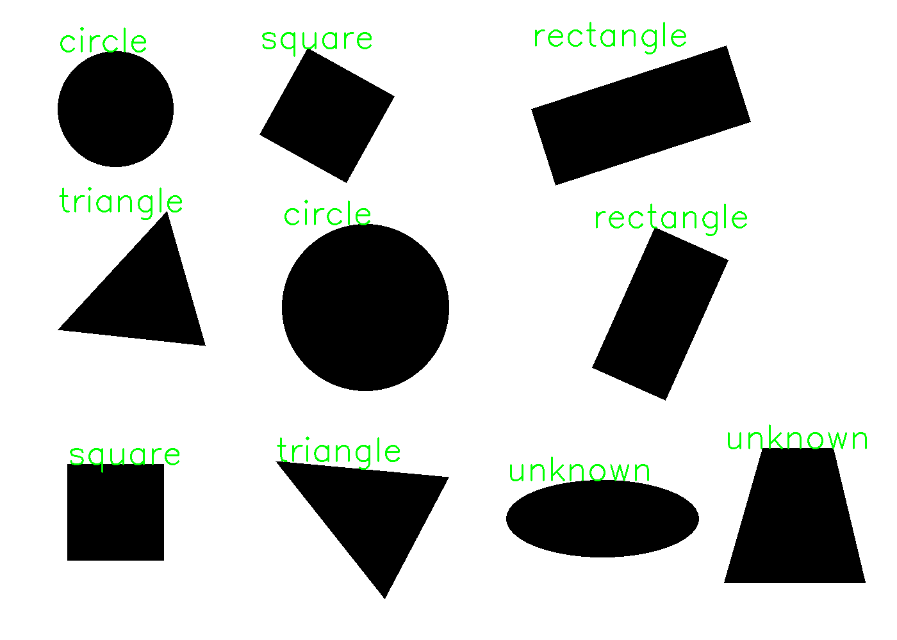

# Shape Detector

Учебный проект на C++ и OpenCV для обнаружения и распознавания геометрических фигур на изображениях.

Программа находит отдельные фигуры, определяет их тип, подсчитывает общее количество и сохраняет изображение с подписями.

## Пример работы

Исходное изображение:

Результат распознавания:

## Поддерживаемые фигуры

- Треугольник — `triangle`
- Круг — `circle`
- Квадрат — `square`
- Прямоугольник — `rectangle`
- Неизвестная фигура — `unknown`

## Как работает программа

1. Загружает изображение и переводит его в оттенки серого.
2. Создаёт бинарную маску с помощью пороговой обработки.
3. Находит внешние контуры объектов.
4. Вычисляет площадь, периметр и округлость каждого контура.
5. Аппроксимирует контуры многоугольниками.
6. Определяет тип фигуры по количеству вершин, округлости,
   углам и соотношению сторон.
7. Подписывает найденные фигуры и сохраняет результат.

Для проверки прямых углов используется нормализованное
скалярное произведение соседних сторон с допуском.

## Технологии

- C++
- OpenCV 4.10
- CMake

## Структура проекта

- `main.cpp` — обработка изображений и классификация фигур.
- `CMakeLists.txt` — настройки сборки.
- `images/` — тестовые изображения.
- `results/` — примеры результатов обработки.
- `.gitignore` — исключения для Git.
- `README.md` — описание проекта.

## Сборка и запуск

Необходимы компилятор C++, CMake и установленная библиотека OpenCV.

Из корневой папки проекта:

    cmake -S . -B build
    cmake --build build
    ./build/project_figures

Путь к исходному изображению задаётся в `cv::imread` в файле
`main.cpp`. Программу нужно запускать из корня проекта,
чтобы относительные пути к изображениям работали корректно.

## Ограничения

Проект рассчитан на отдельные тёмные фигуры на светлом фоне.
Фигуры не должны перекрываться или касаться друг друга.

Классификация основана на геометрических признаках
и заданных допусках. Шум, тени, искажения перспективы
и сложные формы могут приводить к ошибкам распознавания.

## Что я изучила

- Работу с изображениями в OpenCV.
- Пороговую обработку и бинарные маски.
- Поиск и аппроксимацию контуров.
- Геометрические признаки фигур.
- Использование скалярного произведения для проверки углов.
- Организацию кода через функции.
- Сборку проекта с CMake и публикацию через Git.
